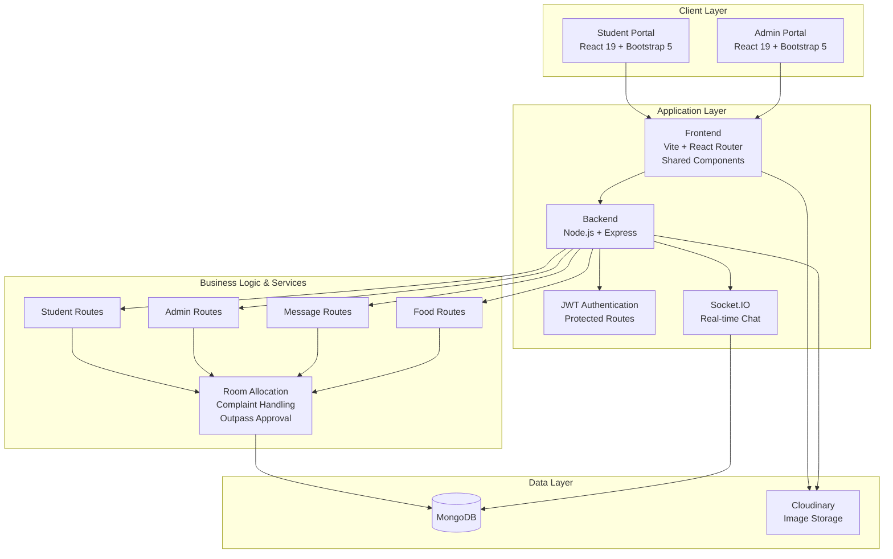
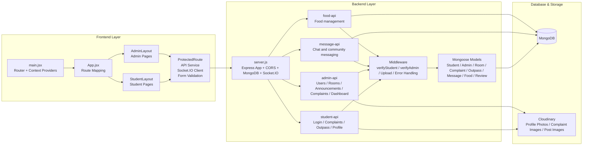
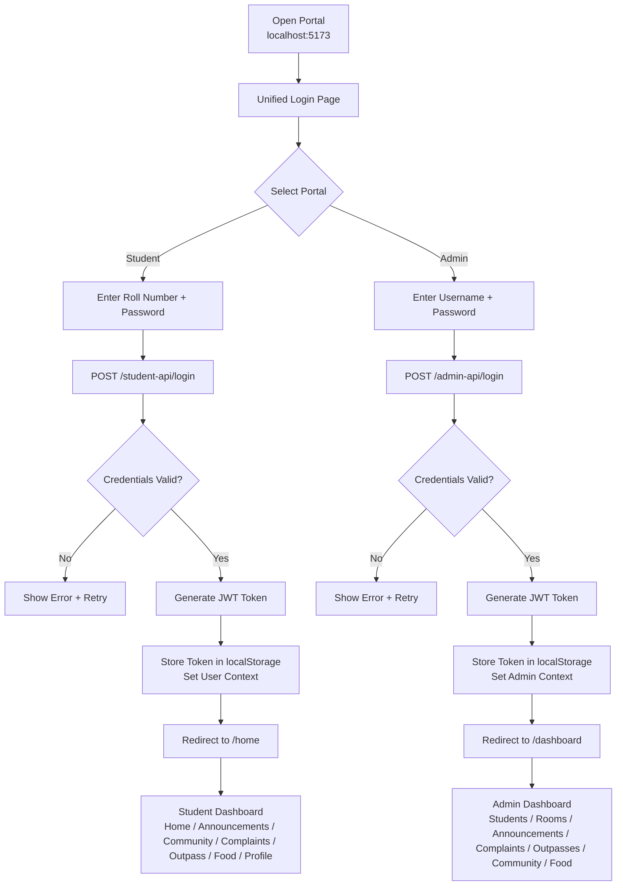
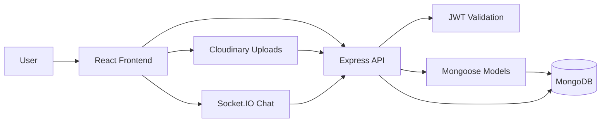

# VJ Hostel Management System - Architecture & User Flow Diagrams

This file contains the system architecture and user flow diagrams for the hostel management application.

---

## 1. High-Level Architecture Diagram

### High-Level Summary
- Student and admin users interact with a unified React frontend.
- All app requests are handled by a single Node.js + Express backend.
- JWT-based authentication protects student/admin routes.
- Real-time messaging is handled through Socket.IO.
- MongoDB stores hostel data, and Cloudinary stores uploaded media.

---

## 2. Low-Level Architecture Diagram

### Low-Level Components
- Frontend route structure:
  - `/login` for unified login
  - `/home/*` for student pages
  - `/dashboard/*` for admin pages
- Backend API modules:
  - `/student-api` for student features
  - `/admin-api` for admin operations
  - `/message-api` for chat services
  - `/food-api` for food planning and listing
- Database models include students, rooms, outpasses, complaints, announcements, community posts, messages, food items, and reviews.
- File uploads are managed through Multer and Cloudinary.

---

## 3. User Flow Diagram

### Main User Tasks Covered by the Flow
- Student login and authentication
- Admin login and authentication
- Redirecting to role-specific dashboards
- Access to all major hostel system modules

---

## 4. Common Feature Flow (Student & Admin)

This flow represents the generic interaction model used across hostel management functionalities such as complaints, room operations, outpasses, announcements, and community chat.

---

## 5. Summary

- Frontend: React 19 + Vite + Bootstrap 5 + React Router
- Backend: Node.js + Express.js + Socket.IO
- Authentication: JWT + Protected routes + Middleware
- Database: MongoDB with Mongoose models
- Storage: Cloudinary for uploaded images
- Core modules: Student management, admin management, complaint handling, room allocation, outpass approval, announcements, community chat, and food service

These diagrams can be used in documentation, presentations, or screenshots for the project architecture overview.
