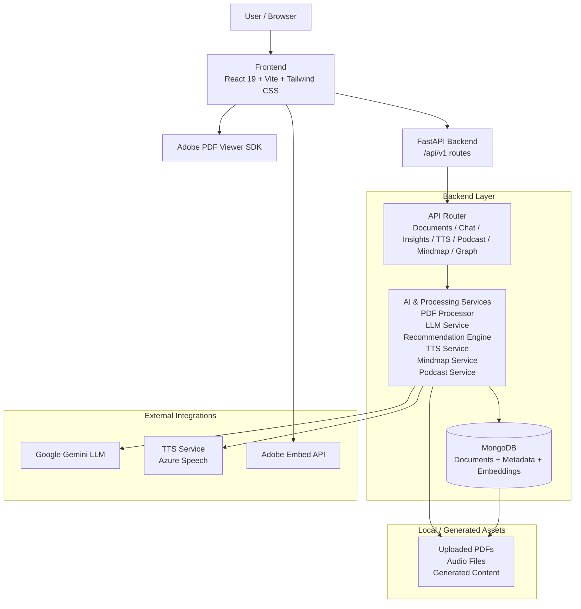
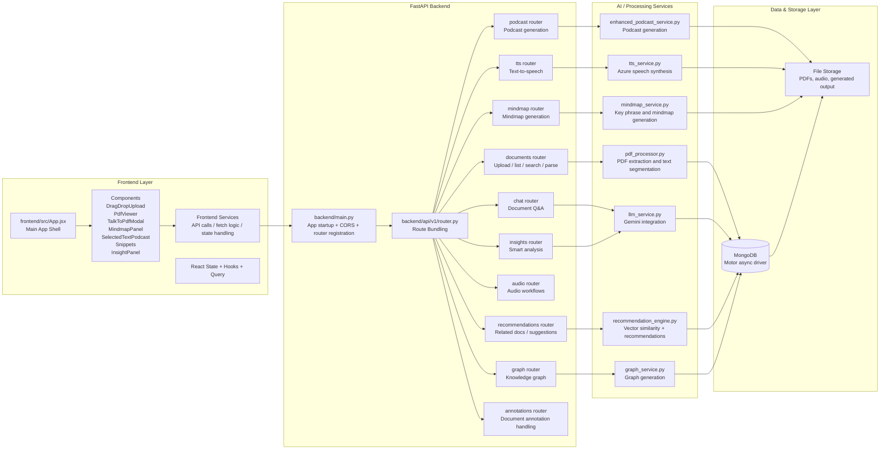
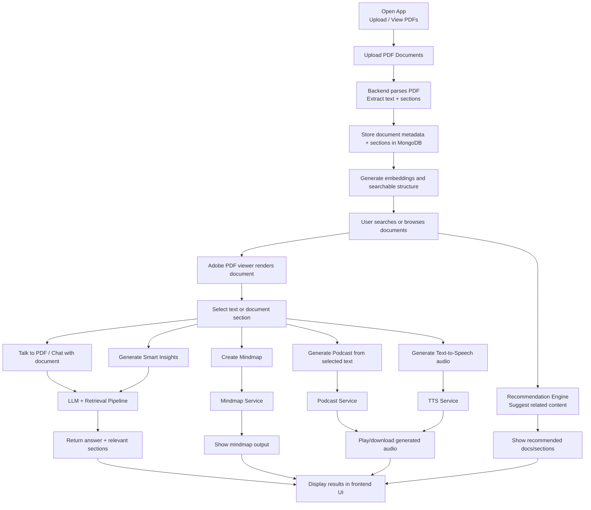
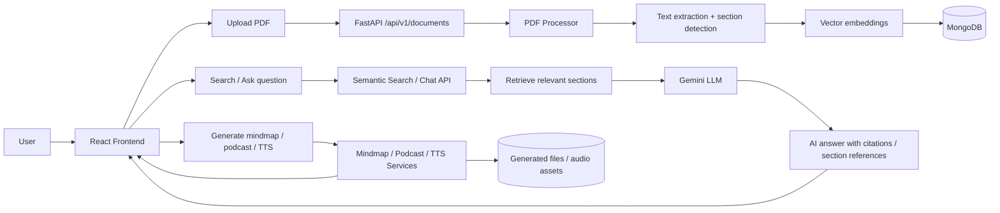
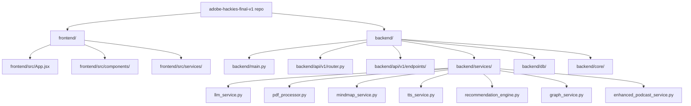

# Adobe Hackies Final v1 - Architecture & User Flow Diagrams

This document describes the architecture of the Adobe Hackies Final v1 project based on the actual repository structure and implementation.

---

## 1. High-Level Architecture Diagram

### High-Level Summary
- The project is a document intelligence platform built around a React frontend and a FastAPI backend.
- The frontend handles PDF viewing, document upload, search, chat, and generated media UI.
- The backend exposes multiple API modules for documents, recommendations, insights, podcast, audio, chat, TTS, mindmap, and annotations.
- AI services process PDFs, generate embeddings, answer questions, build summaries, create podcasts, and synthesize speech.
- MongoDB stores document metadata and embedded sections; generated files are stored as assets.
- External integrations include Google Gemini, Azure TTS, and Adobe PDF Embed API.

---

## 2. Low-Level Architecture Diagram

### Low-Level Structure Breakdown
- Frontend application is a single-page React app with modular components for PDF viewer, upload, chat, recommendations, mindmap, and podcast features.
- App logic is centralized in `frontend/src/App.jsx` and uses component-level UI orchestration for document workflows.
- Backend entry point is `backend/main.py`, which connects MongoDB and configures FastAPI CORS and startup dependencies.
- API endpoints are grouped under `backend/api/v1/router.py` and split across feature-specific modules.
- AI and workflow services live in `backend/services/` and include PDF parsing, LLM orchestration, recommendation engine, audio synthesis, graph generation, and mindmap creation.
- MongoDB is the main persistence layer for document records, metadata, embeddings, session data, and generated analysis content.

---

## 3. User Flow Diagram

### Common User Journey
1. User uploads one or more PDFs.
2. Backend extracts documents, sections, and metadata.
3. Text is embedded for semantic search and similarity matching.
4. User can view PDFs, chat with the document, read insights, generate mindmaps, and create podcasts.
5. The frontend presents results and generated media in a single interactive workspace.

---

## 4. End-to-End Document Intelligence Flow

---

## 5. Repository-Based Architectural Mapping

---

## 6. Architecture Summary

- Frontend: React 19 + Vite + Tailwind CSS + Adobe PDF viewer integration
- Backend: FastAPI with modular API router and feature-specific endpoints
- AI stack: Google Gemini, vector search, recommendation logic, document analysis
- Processing stack: PDF parsing, section extraction, mindmap generation, audio synthesis
- Storage: MongoDB for metadata and embeddings; file storage for documents and generated outputs
- External services: Adobe Embed API, Azure Speech, Google Gemini

This architecture reflects the actual implementation of the repository and maps directly to the project structure in `frontend/`, `backend/`, `backend/services/`, and `backend/api/v1/`.
